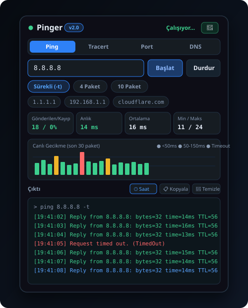
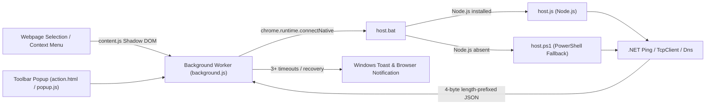

<p align="center">
  
</p>

<p align="center">
  
  
  
  
  <a href="LICENSE"></a>
</p>

<p align="center">
  <strong>English</strong> | <a href="README_TR.md">Türkçe</a>
</p>

---

**Pinger** is a lightweight Manifest V3 browser extension paired with a zero-dependency Windows Native Messaging Host (Node.js with automatic PowerShell fallback). Select or right-click any IP address or hostname on any webpage to run live **ICMP Ping**, **Traceroute**, **TCP Port Checks**, and **DNS / Reverse PTR Lookups** without leaving your browser.

## Visual Preview

<table>
  <tr>
    <td align="center" width="43%">
      <strong>Popup Console &amp; Live Latency Graph</strong><br /><br />
      
    </td>
    <td align="center" width="57%">
      <strong>In-Page Draggable Panel &amp; Recovery Alerts</strong><br /><br />
      
    </td>
  </tr>
</table>

## Features

| Feature | Description |
| :--- | :--- |
| **ICMP Ping (`-t` / `4` / `10`)** | Real-time packet stream using `.NET NetworkInformation.Ping` (bypasses `ping.exe` stdout pipe buffering). |
| **Live Latency Sparkline & Stats** | Color-coded last-30-packet RTT chart (`<50ms`, `50–150ms`, `>150ms`, `Timeout`) plus `Sent / Loss %`, `Last`, `Avg`, and `Min / Max`. |
| **Traceroute (up to 30 hops)** | Hop-by-hop latency probing with fast non-blocking reverse DNS hostname lookup. |
| **TCP Port Scanner** | Probe custom port lists (e.g. `80,443,22,3389,8080`) with `OPEN (ms)` / `CLOSED` status. |
| **DNS & Reverse PTR Lookup** | Resolve `A` (IPv4), `AAAA` (IPv6), aliases, and reverse PTR records for IP addresses. |
| **Down & Recovery Alerts** | Fires a browser + Windows toast alert after **3+ consecutive timeouts** and when the host **recovers**. |
| **In-Page Shadow DOM Panel** | Select an IP for quick-action chips or right-click directly (`Shift + Right Click` preserves the browser's default menu). |
| **Recent Targets & Copy Summary** | Quick-access chips for the last 8 targets, optional timestamps, and one-click copy of stats + terminal log. |

## Architecture



## Quick Install (3 Simple Steps)

### Step 1 — Download & Setup
Pick either method *(no Extension ID copy-pasting needed)*:

- **A) One-Line PowerShell (Fastest):** Open **PowerShell**, paste this command, and press `Enter`:
  ```powershell
  irm https://raw.githubusercontent.com/CanOruckahya/Pinger-Browser-extension/main/scripts/easy-install.ps1 | iex
  ```
- **B) ZIP Download:** Download **`Pinger-v2.0.0-EasyInstall.zip`** from [Releases](https://github.com/CanOruckahya/Pinger-Browser-extension/releases), extract it, and double-click **`EasyInstall.bat`**.

### Step 2 — Add to Browser (Chrome / Edge / Brave)
1. Open `chrome://extensions` *(or `edge://extensions`)*.
2. Turn on **Developer mode** (top right).
3. Click **Load unpacked** → press **`Ctrl + V`** → click **Select Folder** *(the folder path was copied in Step 1)*.

### Step 3 — Use
Refresh any webpage (`F5`), select or right-click an IP/host, and pick **Pingle**, **Tracert**, **Port Tara**, or **DNS Lookup**!

<details>
<summary>Firefox Setup, Uninstall &amp; Manual Notes</summary>

1. **Firefox:** Open `about:debugging#/runtime/this-firefox` → **Load Temporary Add-on** → select [`Pinger/extension/manifest.json`](Pinger/extension/manifest.json).
2. **Uninstall:** Run [`Pinger/uninstall.bat`](Pinger/uninstall.bat) to remove all browser Native Host Registry entries.
3. **Zero dependencies:** Node.js is optional; `host.bat` uses `host.js` if `node` is installed, otherwise it automatically runs `host.ps1` via PowerShell.

</details>

## Project Structure

```text
Pinger-Browser-extension/
├── docs/assets/                # README banner & UI preview SVGs
├── scripts/
│   └── easy-install.ps1        # One-line PowerShell installer
├── Pinger/
│   ├── extension/              # Manifest V3 extension (popup, background, Shadow DOM content script, icons)
│   ├── native-host/            # host.js, host.ps1, host.bat, install-host.ps1 & example manifests
│   ├── EasyInstall.bat         # Zero-prompt double-click installer
│   ├── install.bat             # CLI / custom-ID installer
│   └── uninstall.bat           # Clean Registry removal script
├── LICENSE                     # MIT License
├── README.md                   # English documentation
└── README_TR.md                # Turkish documentation
```

## Troubleshooting

| Symptom | Fix |
| :--- | :--- |
| `Native host bağlantısı koptu` | Run [`Pinger/EasyInstall.bat`](Pinger/EasyInstall.bat) again, reload the extension, and refresh the page (`F5`). |
| Host missing after moving folder | Re-run [`Pinger/EasyInstall.bat`](Pinger/EasyInstall.bat) from the new folder location. |
| Need the browser's default right-click menu on an IP | Hold **`Shift` + Right-Click** on the IP/link to bypass Pinger's custom menu. |
| Enable verbose native host debug logging | Set `PINGER_DEBUG=1` in the environment before launching the browser (`Pinger/native-host/host-debug.log`). |

## License

Released under the [MIT License](LICENSE) by **Can Oruckahya**.
