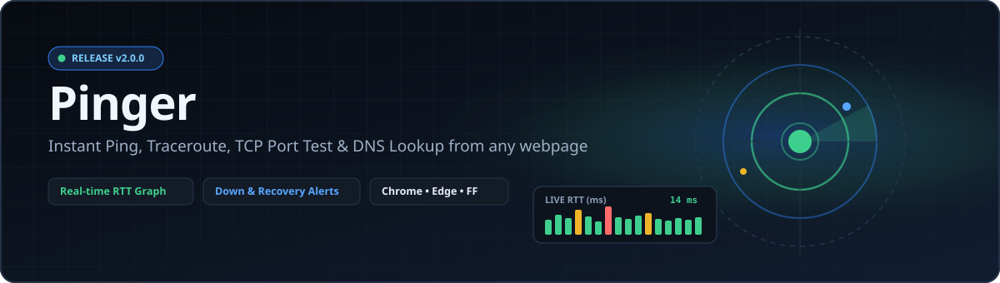
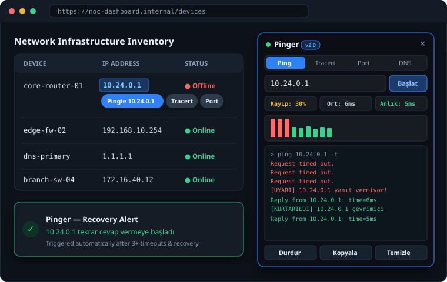
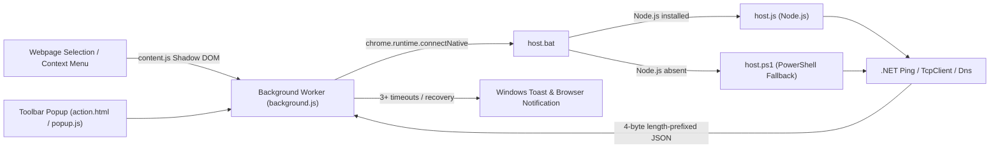

<p align="center">
  
</p>

<p align="center">
  
  
  
  
  <a href="LICENSE"></a>
</p>

<p align="center">
  <strong>English</strong> | <a href="README_TR.md">Türkçe</a>
</p>

---

**Pinger** is a lightweight Manifest V3 browser extension paired with a zero-dependency Windows Native Messaging Host (Node.js with automatic PowerShell fallback). Select or right-click any IP address or hostname on any webpage to run live **ICMP Ping**, **Traceroute**, **TCP Port Checks**, and **DNS / Reverse PTR Lookups** without leaving your browser.

## Visual Preview

<table>
  <tr>
    <td align="center" width="43%">
      <strong>Popup Console &amp; Live Latency Graph</strong><br /><br />
      
    </td>
    <td align="center" width="57%">
      <strong>In-Page Draggable Panel &amp; Recovery Alerts</strong><br /><br />
      
    </td>
  </tr>
</table>

## Features

| Feature | Description |
| :--- | :--- |
| **ICMP Ping (`-t` / `4` / `10`)** | Real-time packet stream using `.NET NetworkInformation.Ping` (bypasses `ping.exe` stdout pipe buffering). |
| **Live Latency Sparkline & Stats** | Color-coded last-30-packet RTT chart (`<50ms`, `50–150ms`, `>150ms`, `Timeout`) plus `Sent / Loss %`, `Last`, `Avg`, and `Min / Max`. |
| **Traceroute (up to 30 hops)** | Hop-by-hop latency probing with fast non-blocking reverse DNS hostname lookup. |
| **TCP Port Scanner** | Probe custom port lists (e.g. `80,443,22,3389,8080`) with `OPEN (ms)` / `CLOSED` status. |
| **DNS & Reverse PTR Lookup** | Resolve `A` (IPv4), `AAAA` (IPv6), aliases, and reverse PTR records for IP addresses. |
| **Down & Recovery Alerts** | Fires a browser + Windows toast alert after **3+ consecutive timeouts** and when the host **recovers**. |
| **In-Page Shadow DOM Panel** | Select an IP for quick-action chips or right-click directly (`Shift + Right Click` preserves the browser's default menu). |
| **Recent Targets & Copy Summary** | Quick-access chips for the last 8 targets, optional timestamps, and one-click copy of stats + terminal log. |

## Architecture



## Easy Install (No Extension ID Copy-Paste)

Because [`Pinger/extension/manifest.json`](Pinger/extension/manifest.json) ships with a fixed public `"key"`, Chromium browsers always assign the deterministic Extension ID `gfepdmddjmpndndaacmopoppcpkcdfjb` (and Firefox uses `pinger@local`).

### Option 1 — One-Line PowerShell Easy Install (Recommended)

Run this in **PowerShell** (downloads Pinger to `%LOCALAPPDATA%\Pinger`, registers Chrome/Edge/Brave/Firefox hosts automatically, and copies the `extension` path to your clipboard):

```powershell
irm https://raw.githubusercontent.com/CanOruckahya/Pinger-Browser-extension/main/scripts/easy-install.ps1 | iex
```

Then open `chrome://extensions` or `edge://extensions` → enable **Developer mode** → **Load unpacked** → press `Ctrl+V`!

### Option 2 — GitHub Releases ZIP + `EasyInstall.bat`

1. Download **`Pinger-v2.0.0-EasyInstall.zip`** from the [Releases](https://github.com/CanOruckahya/Pinger-Browser-extension/releases) page and extract it.
2. Double-click [`Pinger/EasyInstall.bat`](Pinger/EasyInstall.bat) — no prompts, registers all browsers automatically and copies the `extension` path to your clipboard.
3. Open `chrome://extensions` or `edge://extensions` → **Developer mode** → **Load unpacked** → press `Ctrl+V`.

---

## Manual Installation

### 1. Load the Browser Extension
**Chrome / Edge / Brave**
1. Open `chrome://extensions`, `edge://extensions`, or `brave://extensions`.
2. Enable **Developer mode** → click **Load unpacked** → select [`Pinger/extension`](Pinger/extension).
3. Copy the generated **Extension ID** (32 characters).

**Firefox**
1. Open `about:debugging#/runtime/this-firefox`.
2. Click **Load Temporary Add-on** → select [`Pinger/extension/manifest.json`](Pinger/extension/manifest.json) (fixed ID: `pinger@local`).

### 2. Register the Native Messaging Host
Run [`Pinger/install.bat`](Pinger/install.bat) (double-click or pass the Extension ID directly):

```bat
cd Pinger
install.bat <CHROME_EDGE_BRAVE_EXTENSION_ID>
```

> **Note:** Node.js is optional. `host.bat` uses `host.js` if `node` is in `PATH`, otherwise it falls back automatically to `host.ps1` via Windows PowerShell.

To cleanly remove all Windows Registry entries later, run [`Pinger/uninstall.bat`](Pinger/uninstall.bat).

### 3. Reload & Use
1. Click **Reload** on the extension card and press `F5` on your open webpage.
2. Select any IP/host or right-click on it → choose **Pingle**, **Tracert**, **Port Tara**, or **DNS Lookup**.

## Project Structure

```text
Pinger-Browser-extension/
├── docs/assets/                # README banner & UI preview SVGs
├── Pinger/
│   ├── extension/              # Manifest V3 extension (popup, background, Shadow DOM content script, icons)
│   ├── native-host/            # host.js, host.ps1, host.bat, install-host.ps1 & example manifests
│   ├── install.bat             # One-click Registry & manifest setup (Chrome, Edge, Brave, Firefox)
│   └── uninstall.bat           # Clean Registry removal script
├── LICENSE                     # MIT License
├── README.md                   # English documentation
└── README_TR.md                # Turkish documentation
```

## Troubleshooting

| Symptom | Fix |
| :--- | :--- |
| `Native host bağlantısı koptu` | Run `install.bat <EXTENSION_ID>` again, then reload the extension and refresh the page (`F5`). |
| Extension ID changed after moving folder | Re-run `install.bat` with the new ID so `com.pinger.host.json` updates its `path` and `allowed_origins`. |
| Need the browser's default right-click menu on an IP | Hold **`Shift` + Right-Click** on the IP/link to bypass Pinger's custom menu. |
| Enable verbose native host debug logging | Set `PINGER_DEBUG=1` in the environment before launching the browser (`Pinger/native-host/host-debug.log`). |

## License

Released under the [MIT License](LICENSE) by **Can Oruckahya**.
