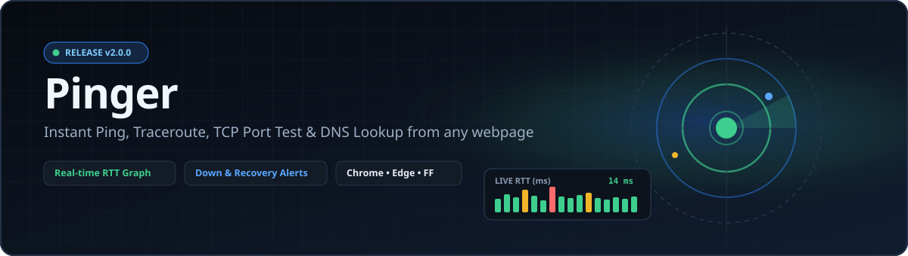
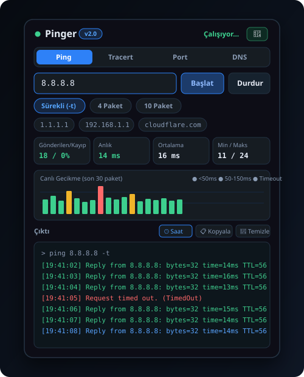
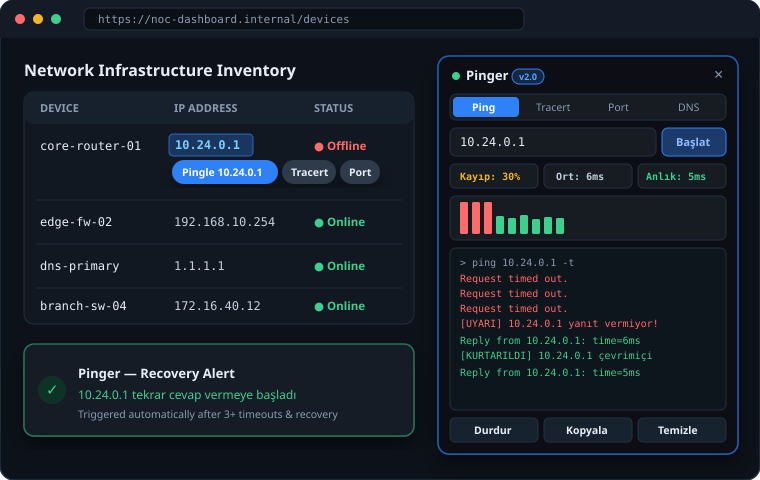
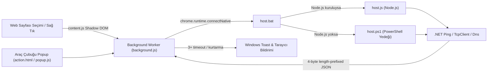

<p align="center">
  
</p>

<p align="center">
  
  
  
  
  <a href="LICENSE"></a>
</p>

<p align="center">
  <a href="README.md">English</a> | <strong>Türkçe</strong>
</p>

---

**Pinger**, Windows Native Messaging Host (Node.js + otomatik PowerShell yedeği) ile çalışan hafif bir Manifest V3 tarayıcı eklentisidir. Herhangi bir web sayfasında bir IP adresini veya host adını seçip sağ tıklayarak tarayıcıdan çıkmadan canlı **ICMP Ping**, **Tracert**, **TCP Port Taraması** ve **DNS / Reverse PTR Sorgusu** çalıştırabilirsiniz.

## Görsel Önizleme

<table>
  <tr>
    <td align="center" width="43%">
      <strong>Popup Konsol ve Canlı Gecikme Grafiği</strong><br /><br />
      
    </td>
    <td align="center" width="57%">
      <strong>Sayfa İçi Sürüklenebilir Panel ve Bildirimler</strong><br /><br />
      
    </td>
  </tr>
</table>

## Özellikler

| Özellik | Açıklama |
| :--- | :--- |
| **ICMP Ping (`-t` / `4` / `10`)** | `.NET NetworkInformation.Ping` ile kesintisiz canlı paket akışı (`ping.exe` pipe buffer takılmasını aşar). |
| **Canlı Gecikme Grafiği & İstatistik** | Son 30 paketin renk kodlu RTT grafiği (`<50ms`, `50–150ms`, `>150ms`, `Timeout`) ile `Gönderilen / Kayıp %`, `Anlık`, `Ortalama` ve `Min / Maks`. |
| **Tracert (maks. 30 hop)** | Adım adım rota takibi ve engel oluşturmayan hızlı ters DNS çözümlemesi. |
| **TCP Port Tarayıcı** | Belirtilen port listesini (ör. `80,443,22,3389,8080`) 2000 ms timeout ile test edip `OPEN (ms)` / `CLOSED` gösterir. |
| **DNS & Reverse PTR Lookup** | Domainler için `A` (IPv4), `AAAA` (IPv6) ve IP adresleri için Reverse PTR kayıtlarını listeler. |
| **Kesinti & Kurtarma Bildirimleri** | Ardışık **3+ timeout** sonrası kesinti uyarısı ve hedef **tekrar yanıt verince** Windows + tarayıcı bildirimi gönderir. |
| **Sayfa İçi Shadow DOM Paneli** | IP seçince hızlı butonlar veya sağ tık menüsü açılır (`Shift + Sağ Tık` ile tarayıcının normal menüsü korunur). |
| **Son Hedefler & Özet Kopyalama** | Son 8 hedef için hızlı çipler, isteğe bağlı saat damgası ve istatistik + log kopyalama butonu. |

## Mimari



## Kurulum

### 1. Tarayıcı Eklentisini Yükle
**Chrome / Edge / Brave**
1. `chrome://extensions`, `edge://extensions` veya `brave://extensions` adresini açın.
2. **Geliştirici modu**nu açın → **Paketlenmemiş öğe yükle** → [`Pinger/extension`](Pinger/extension) klasörünü seçin.
3. Oluşan **Extension ID** değerini kopyalayın.

**Firefox**
1. `about:debugging#/runtime/this-firefox` adresini açın.
2. **Geçici eklenti yükle** → [`Pinger/extension/manifest.json`](Pinger/extension/manifest.json) dosyasını seçin (sabit ID: `pinger@local`).

### 2. Native Host Kaydını Yap
[`Pinger/install.bat`](Pinger/install.bat) dosyasını çalıştırın (çift tıklayın veya ID'yi parametre olarak verin):

```bat
cd Pinger
install.bat <CHROME_EDGE_BRAVE_EXTENSION_ID>
```

> **Not:** Node.js şart değildir. `host.bat` bilgisayarda Node.js varsa `host.js`'i, yoksa otomatik olarak PowerShell (`host.ps1`) sürümünü çalıştırır.

Kayıt defteri anahtarlarını kaldırmak için [`Pinger/uninstall.bat`](Pinger/uninstall.bat) dosyasını kullanabilirsiniz.

### 3. Yenile ve Kullan
1. Eklenti kartından **Yeniden yükle**'ye tıklayın ve açık sayfayı `F5` ile yenileyin.
2. Herhangi bir IP/host seçin veya üzerine sağ tıklayın → **Pingle**, **Tracert**, **Port Tara** ya da **DNS Lookup** seçin.

## Sorun Giderme

| Durum | Çözüm |
| :--- | :--- |
| `Native host bağlantısı koptu` | `install.bat <EXTENSION_ID>` komutunu tekrar çalıştırın, eklentiyi yenileyip sayfada `F5` yapın. |
| Klasör taşındığı için host bulunamıyor | `install.bat` dosyasını yeni klasörden tekrar çalıştırın (`com.pinger.host.json` yolu güncellenir). |
| IP üzerinde tarayıcının normal sağ tık menüsü lazım | **`Shift` + Sağ Tık** yaptığınızda Pinger menüsü atlanır ve tarayıcı menüsü açılır. |

## Lisans

**Can Oruckahya** — [MIT Lisansı](LICENSE)
